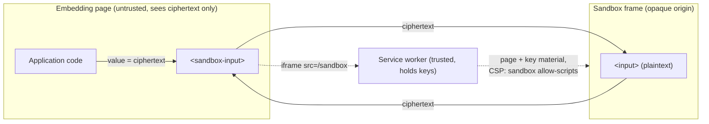

# Design

`sandbox-component` limits access to sensitive form data, such as PII, to the code that fetches, displays, and updates it.

In a typical web form, PII in an `<input>` is readable by every script in the input's frame and in any same-origin frame that can reach it. With `sandbox-component`, the embedding page only ever handles ciphertext. Plaintext exists only inside a sandboxed frame.

## Terms

- **Embedding page:** the untrusted page that contains the form.
- **Sandbox element:** a [custom element](https://developer.mozilla.org/en-US/docs/Web/API/Web_components/Using_custom_elements) that replaces a sensitive form control, for example `<sandbox-input>` for `<input>`.
- **Sandbox frame:** the iframe that a sandbox element inserts. It implements the real form control.
- **Opaque origin:** an [origin](https://developer.mozilla.org/en-US/docs/Glossary/Origin) that is equal to no other origin, so no other frame can access its DOM or storage.

## Overview

1. PII in the application's data model is encrypted. The [service worker](https://developer.mozilla.org/en-US/docs/Web/API/Service_Worker_API) holds the decryption keys.
2. Each sandbox element inserts `<iframe src="/sandbox">`.
3. The service worker answers that navigation itself and never forwards it to the network. Its response carries the key material and the form control's implementation, plus the header `Content-Security-Policy: sandbox allow-scripts`.
4. The embedding page sets the sandbox element's `value` to ciphertext. The element sends it to the frame, and the frame decrypts it and shows the plaintext.
5. When the user edits the value, the frame encrypts the plaintext and sends the ciphertext back. The element then updates its `value`.

## Isolation

The [CSP `sandbox` directive](https://developer.mozilla.org/en-US/docs/Web/HTTP/Reference/Headers/Content-Security-Policy/sandbox) gives every document loaded from the response an opaque origin. This holds wherever the document loads: in an iframe with or without a `sandbox` attribute, in a new window, or by direct navigation. The frame omits `allow-same-origin`. Permissions beyond `allow-scripts` will be added only when they're needed.

The directive applies only to documents ([CSP3 §6.3.2](https://w3c.github.io/webappsec-csp/#directive-sandbox)). A `fetch` of `/sandbox` would read the key material, so the service worker serves the page only when `request.mode` is `"navigate"`. Page script can't forge that mode, because `new Request(url, { mode: "navigate" })` throws a `TypeError` ([Fetch](https://fetch.spec.whatwg.org/#dom-request)).

This protection holds only while the service worker is running. Untrusted same-origin script can unregister it, and then `/sandbox` reaches the server. The server must never serve key material at `/sandbox`.

## Out of scope

`sandbox-component` provides primitives that applications can use to address these threats.

- **Key provisioning.** The design assumes the data is encrypted and the service worker has the keys. How that happens is up to the application. For example, the worker can intercept API responses and encrypt their PII fields.
- **Decryption oracle.** The embedding page can send any ciphertext to any frame for display. An application can bind ciphertext to its field, for example with [AEAD](https://developer.mozilla.org/en-US/docs/Web/API/AesGcmParams) associated data.
- **Channel integrity.** The channel between a sandbox element and its frame is untrusted. An application can give the frame keys and use authenticated encryption over it. The embedding page can then drop messages but can't read or alter them undetected.
- **Spectre.** A same-site sandbox frame may share a process with the embedding page. An application can render the control in a nested `blob:` URL frame, which Chromium's site isolation treats as cross-site ([Edge: Deep dive into Site Isolation](https://microsoftedge.github.io/edgevr/posts/deep-dive-into-site-isolation-part-1/#:~:text=Blob%20URL%20with%20opaque%20origin)).
- **Clickjacking.** The embedding page controls the DOM around the frame. It can overlay the frame or swap in a fake control.
