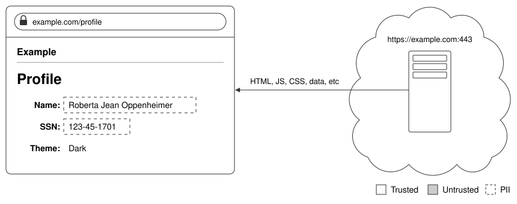

# Abstract

Normally the [origin](background.md#origin) is the smallest trust boundary the browser enforces. Every script in a frame, and in every [same-origin](background.md#same-origin-policy) frame it can reach, can read and change the same DOM, storage, and credentials. However, an origin can create finer-grained trust boundaries at the granularity of [service worker](background.md#service-worker) [scopes](background.md#scope), using a service worker, the [Content-Security-Policy](background.md#content-security-policy) header [`sandbox` directive](background.md#csp-sandbox-directive), and an [iframe](https://developer.mozilla.org/en-US/docs/Web/HTML/Reference/Elements/iframe).

# Introduction

## Background

The following assumes familiarity with the concepts in [./background.md](./background.md).

## Motivation

Consider a web application that displays a user's profile, including personally identifiable information (PII) such as their address. Any and all code running in the profile page can read that PII. Components of the application (code and infrastructure, e.g.) that can read PII are said to be _trusted_. Collectively, an application's trusted components are referred to as its _trusted computing base_ or TCB.

Due to its sensitivity, PII is regulated in almost every jurisdiction—often by multiple regulatory bodies. In order to prove that the web application is following the law, its provider is usually required to demonstrate that all portions of its TCB under the provider's control are compliant. This typically involves annual audits by an independent third party. In the simple example above, this is not a serious burden. However, the TCB for the profile page of a typical modern web application includes many more components.

![The same profile page, served by a simplified modern web application at https://example.com:443. The browser requests /profile from a web server, which queries GraphQL for the profile data. GraphQL fetches the requested data from a profile microservice backed by a database. Once GraphQL returns the result of the query, the server responds with the page's HTML and then handles requests for the page's other resources, including scripts, styles, and images. The code running in the browser and on all of the infrastructure described above is deployed by a CI service combining code from the origin with third-party code. All of these components are trusted.](modern-app.svg)

Modern web applications can easily comprise hundreds of thousands or even millions of lines of code deployed on a diverse collection of infrastructure running millions of lines of third-party code. Securing a trusted computing base of this size is a daunting task made significantly more challenging by emerging agentic threats.

This is not a new problem. Academia and industry have grappled with the challenge of securing complex systems for decades. The most important result of this work is the idea that rather than trusting the entire system with sensitive information, only those components of the application with a need to know sensitive information should be trusted and everything else should be untrusted. The standard way to apply this principle on the web is to host the PII on another origin and embed it in the page using iframes.

Because the PII frame is not from the same origin as the page, the browser prevents the page from reading the contents of the frame (or any other resource from the PII origin). As a result, the page and its origin are both untrusted.

While this architecture achieves our goal of shrinking the application's TCB, it comes with some downsides. First, the application must ensure the origin only returns PII for authenticated requests. Second, each PII frame in the page degrades the application's robustness and performance, as each makes a network request to the PII origin that can fail or take a long time. Finally, the application must ensure that the PII is styled appropriately. This list is not exhaustive.

Browsers support another way for the web application to put the PII in a cross-origin iframe: the HTTP Content-Security-Policy (CSP) sandbox directive. The application can serve the PII frame on the page's origin, but ensure it is cross-origin to the page by including the CSP sandbox directive when returning the frame's HTML. Using a layer 7 router, the application can serve PII from a dedicated server and avoid trusting the rest of the web application.

This architecture removes the need for cross-origin authentication without significantly changing the size of the TCB. However, each PII frame still requires a network round trip to render. Using a service worker, the application can serve the PII frame from the browser without making a network request, but the worker code would need to include any PII data the page needs, which is inconvenient. Instead, we can encrypt the PII in the page and include the key in the service worker code.

![The same profile page, with the name and address each in an iframe whose src is /pii/ followed by the field's ciphertext, such as /pii/abc123. At https://example.com:443, a layer 7 router routes /pii/* to a PII server and other paths, including /profile, to the web server. The web server fetches the encrypted PII from the PII server and puts it in each iframe's src. A service worker in the browser fetches its code, /pii/sw.js, from the PII server, then answers each iframe's request without the network, responding with the decrypted PII and Content-Security-Policy: sandbox. The browser, the iframes, the service worker, the router, and the PII server are trusted. The rest of the page and the web server are untrusted.](service-worker.svg)

## A Minimal Proof-of-Concept

See [`examples/minimal-poc`](../examples/minimal-poc) for a full proof-of-concept demonstrating this architecture. When the page loads with the service worker already installed:

1. The page finds the worker's registration with `getRegistrations()` and sends the worker a message.
2. The worker encrypts the string "setec astronomy" with its AES-GCM key and replies with the ciphertext.
3. The page inserts `<iframe src="/sandbox#<ciphertext>">`.
4. The worker answers the frame's request with a document that contains the key and a script, and with `Content-Security-Policy: sandbox allow-scripts`.
5. The frame's script decrypts the fragment and displays the plaintext.

## Necessary Constraints

This proof-of-concept has several vulnerabilities that must be mitigated.

### Any client can read the secret

Any client, not only the page, can request `/sw.js` and read the key. To prevent this, the server must return the worker's script only for authenticated requests, and return an error otherwise.

### The page can read the worker's source

Any page script can fetch `/sw.js` and read the key. To prevent this, the server must serve the worker's script only to requests with [`Sec-Fetch-Dest: serviceworker`](https://developer.mozilla.org/en-US/docs/Web/HTTP/Reference/Headers/Sec-Fetch-Dest), which scripts can't set, and [`Service-Worker: script`](https://w3c.github.io/ServiceWorker/#service-worker), and with `Cache-Control: no-store`, so the page can't read it from the HTTP cache. If either header is missing, the server must return `403 Forbidden`.

### The page can read the frame's document

The worker answers every request for `/sandbox`, not only navigations, and the `sandbox` directive doesn't apply to a `fetch` response. The page can create a same-origin iframe the worker controls, such as one at `/sandbox/x`, and call that frame's `fetch("/sandbox")` to read the key. To prevent this, the worker must only respond to requests whose [`mode`](https://developer.mozilla.org/en-US/docs/Web/API/Request/mode) is `"navigate"` and whose [`destination`](https://developer.mozilla.org/en-US/docs/Web/API/Request/destination) is `"iframe"`, which scripts can't set.
