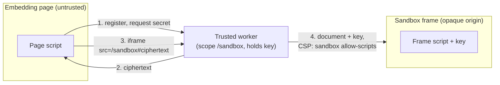

# Design

`trusted-scopes` describes how an [origin](https://developer.mozilla.org/en-US/docs/Glossary/Origin) can create trust boundaries at the granularity of [service worker](https://developer.mozilla.org/en-US/docs/Web/API/Service_Worker_API) scopes, using a service worker, the [CSP `sandbox` directive](https://developer.mozilla.org/en-US/docs/Web/HTTP/Reference/Headers/Content-Security-Policy/sandbox), and an iframe. It also describes and demonstrates use cases of this primitive.

Normally the origin is the smallest trust boundary the browser enforces. Every script in a frame, and in every same-origin frame it can reach, can read and change the same DOM, storage, and credentials.

## Terms

- **Scope:** the URL prefix a service worker registration controls. A navigation goes to the registration whose scope is the longest match for its URL ([Service Workers, Match Service Worker Registration](https://w3c.github.io/ServiceWorker/#scope-match-algorithm)).
- **Trusted worker:** a service worker whose script the origin trusts. It holds its scope's secrets and serves the sandbox frames in its scope.
- **Sandbox frame:** an iframe whose document a trusted worker serves with `Content-Security-Policy: sandbox allow-scripts`.
- **Opaque origin:** an origin equal to no other origin, so no other frame can access its DOM or JavaScript globals. The `sandbox` directive gives a sandbox frame's document an opaque origin wherever it loads.
- **Embedding page:** the untrusted page that hosts a sandbox frame.

## Trust boundaries

A trust boundary is a trusted worker's scope. The worker builds each sandbox frame's document itself, so the frame runs only the worker's code and holds only the worker's secrets. The embedding page can create the frame and exchange messages with it, but can't read or change its contents.

An origin can register several workers with overlapping scopes. For example, a worker scoped to `/sandbox/payments` serves the frames under that prefix, and a worker scoped to `/sandbox` serves the rest.

## Minimal example

[`examples/minimal-poc`](../examples/minimal-poc) demonstrates the primitive with one secret, the string "setec astronomy".

1. The page registers `sw.js` with scope `/sandbox`, unless [`getRegistrations()`](https://developer.mozilla.org/en-US/docs/Web/API/ServiceWorkerContainer/getRegistrations) already has that registration. The worker never controls the page.
2. Once the worker is active, the page asks it for the secret with `postMessage`.
3. The worker encrypts the secret with an AES-GCM key from its own source and replies with the ciphertext.
4. The page inserts `<iframe src="/sandbox#<ciphertext>">`. Browsers don't send the fragment to the server.
5. The worker answers the `/sandbox` navigation with the frame's document, which contains the key and a script, and with `Content-Security-Policy: sandbox allow-scripts`. The frame decrypts its fragment and shows the plaintext.

Its tests run in Chromium, Firefox, and WebKit and check that:

- the frame shows the plaintext;
- page code can't reach the frame's JavaScript globals or DOM: reading `eval`, `crypto`, or `document` through its `contentWindow` throws `SecurityError`, and its `contentDocument` is `null`;
- the frame's origin is `"null"`.

Without the CSP header, the last two checks fail.

The example ignores known attacks. For example, any page script can fetch `/sw.js` and read the key.
