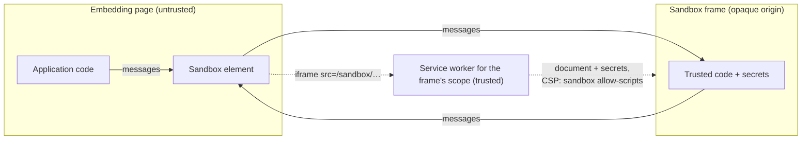

# Design

`trusted-scopes` creates trust boundaries within a web application at a finer grain than an [origin](https://developer.mozilla.org/en-US/docs/Glossary/Origin). Normally the origin is the smallest trust boundary the browser enforces: every script in a frame, and in every same-origin frame it can reach, can read and change the same DOM, storage, and credentials. `trusted-scopes` puts code and data that need protection in a sandboxed frame. That frame is served by a trusted [service worker](https://developer.mozilla.org/en-US/docs/Web/API/Service_Worker_API), and the rest of the page can only send it messages.

## Terms

- **Embedding page:** the untrusted page that hosts a sandbox element.
- **Sandbox element:** a [custom element](https://developer.mozilla.org/en-US/docs/Web/API/Web_components/Using_custom_elements) that inserts a sandbox frame and relays messages between it and the embedding page.
- **Sandbox frame:** an iframe whose document has an opaque origin and is served by a trusted service worker.
- **Opaque origin:** an origin that is equal to no other origin, so no other frame can access its DOM or storage.

## Trust boundaries

A trust boundary is a service-worker scope. An origin can register several service workers with overlapping scopes. Each navigation goes to the registration whose scope is the longest match for its URL ([Service Workers, Match Service Worker Registration](https://w3c.github.io/ServiceWorker/#scope-match-algorithm)). For example, a worker scoped to `/sandbox/payments/` handles the frames under that path. A worker scoped to `/` handles the rest of the application. Each worker holds only its own boundary's secrets.

1. A sandbox element inserts an iframe whose `src` is a URL in a trusted worker's scope.
2. The worker answers that navigation itself and never forwards it to the network. Its response carries the frame's code and secrets, plus the header `Content-Security-Policy: sandbox allow-scripts`.
3. The embedding page and the frame exchange messages only, through the sandbox element.

## Isolation

The [CSP `sandbox` directive](https://developer.mozilla.org/en-US/docs/Web/HTTP/Reference/Headers/Content-Security-Policy/sandbox) gives every document loaded from the response an opaque origin. This holds wherever the document loads: in an iframe with or without a `sandbox` attribute, in a new window, or by direct navigation. The frame omits `allow-same-origin`. Permissions beyond `allow-scripts` will be added only when they're needed.

The directive applies only to documents ([CSP3 §6.3.2](https://w3c.github.io/webappsec-csp/#directive-sandbox)). A `fetch` of the frame's URL would read its secrets, so the worker serves the frame only when `request.mode` is `"navigate"`. Page script can't forge that mode, because `new Request(url, { mode: "navigate" })` throws a `TypeError` ([Fetch](https://fetch.spec.whatwg.org/#dom-request)).

This protection holds only while the worker is running. Untrusted same-origin script can unregister it, and then the frame's URL reaches the server. The server must never serve secrets at a sandbox frame URL.

Untrusted script can also register its own worker with a narrower scope, which would take over a boundary's frames. The browser sends `Service-Worker: script` when it fetches a worker script ([Service Workers](https://w3c.github.io/ServiceWorker/#service-worker-script-request)). The server must reject any request carrying that header for a URL other than a trusted worker's script. That rule leaves the adversary only the trusted scripts to register. Each trusted script lives at its own scope's path, and the server never sends [`Service-Worker-Allowed`](https://w3c.github.io/ServiceWorker/#service-worker-allowed), so a trusted script can't control a scope outside its own path. If the adversary registers one trusted script at a scope inside another's, frames there get no secrets, which denies service but leaks nothing.

## Example: PII in a form

In a typical form, PII in an `<input>` is readable by every script on the page. With `trusted-scopes`, only the code that fetches, displays, and updates the PII can read it. The embedding page handles ciphertext only.

1. PII in the application's data model is encrypted, and the worker holds the keys.
2. `<sandbox-input>` replaces `<input>`. Its frame implements the real `<input>` and receives the key material from the worker.
3. The embedding page sets the element's `value` to ciphertext. The frame decrypts it and shows the plaintext.
4. When the user edits the field, the frame encrypts the new plaintext. The element's `value` becomes the new ciphertext.

## Out of scope

`trusted-scopes` provides primitives that applications can use to address these threats.

- **Key provisioning.** The design assumes the worker has the secrets. How it gets them is up to the application. For example, a worker can intercept API responses and encrypt their PII fields.
- **Decryption oracle.** The embedding page can send any ciphertext to any frame. An application can bind ciphertext to its field, for example with [AEAD](https://developer.mozilla.org/en-US/docs/Web/API/AesGcmParams) associated data.
- **Channel integrity.** The channel between a sandbox element and its frame is untrusted. An application can give the frame keys and use authenticated encryption over it. The embedding page can then drop messages but can't read or alter them undetected.
- **Spectre.** A same-site sandbox frame may share a process with the embedding page. An application can run its sensitive code in a nested `blob:` URL frame, which Chromium's site isolation treats as cross-site ([Edge: Deep dive into Site Isolation](https://microsoftedge.github.io/edgevr/posts/deep-dive-into-site-isolation-part-1/#:~:text=Blob%20URL%20with%20opaque%20origin)).
- **Clickjacking.** The embedding page controls the DOM around the frame. It can overlay the frame or swap in a fake one.
