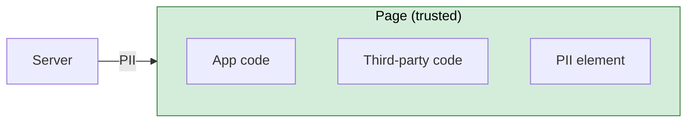
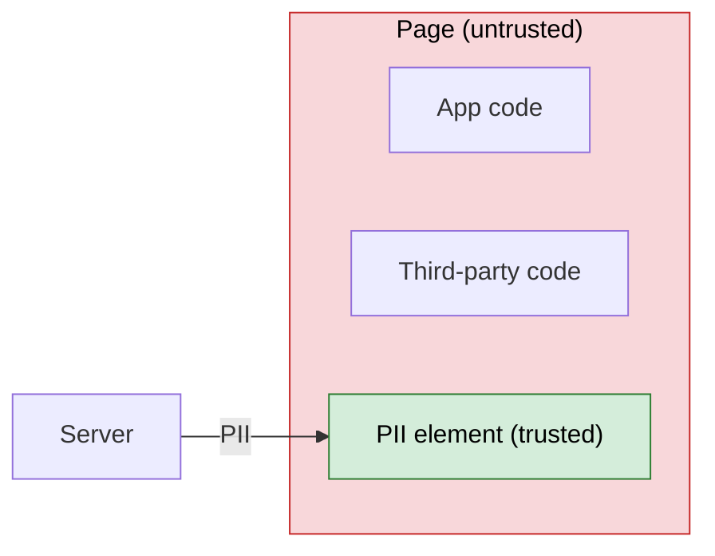
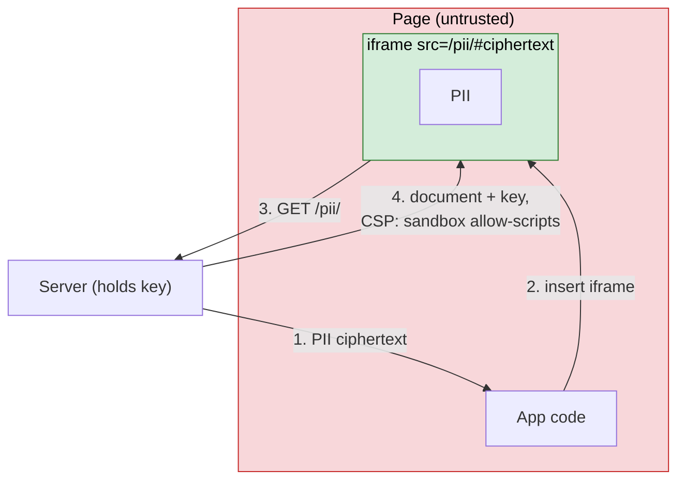
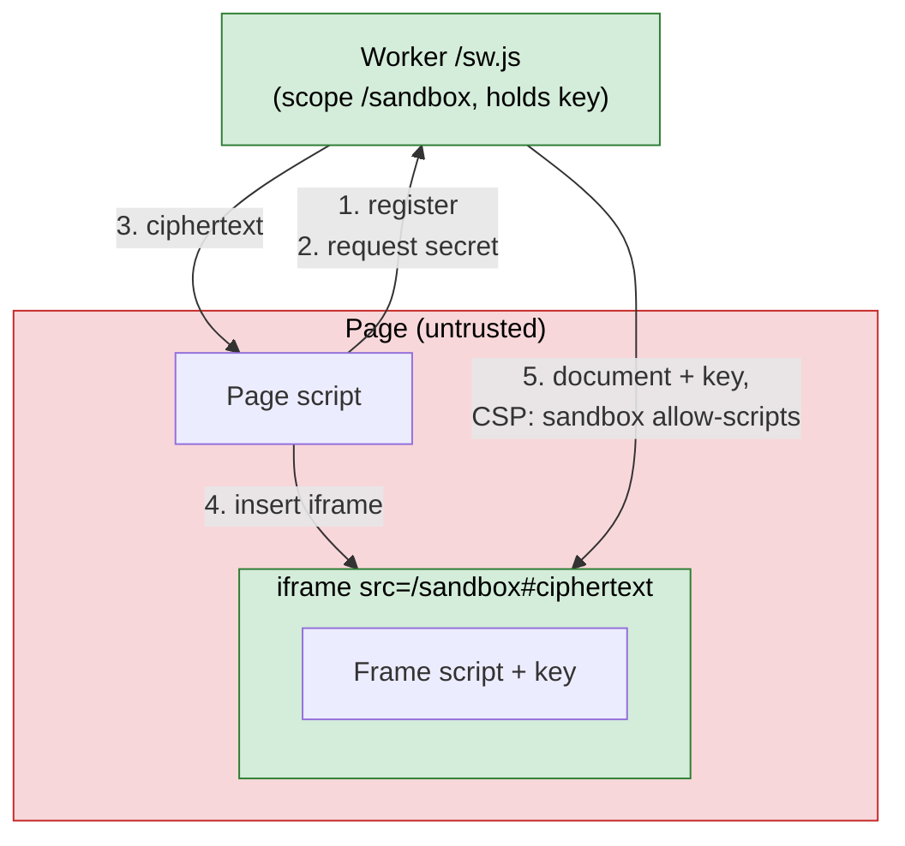

# Abstract

Normally the origin is the smallest trust boundary the browser enforces. Every script in a frame, and in every same-origin frame it can reach, can read and change the same DOM, storage, and credentials. However, an [origin](https://developer.mozilla.org/en-US/docs/Glossary/Origin) can create finer-grained trust boundaries at the granularity of [service worker](https://developer.mozilla.org/en-US/docs/Web/API/Service_Worker_API) scopes, using a service worker, the [Content-Security-Policy header `sandbox` directive](https://developer.mozilla.org/en-US/docs/Web/HTTP/Reference/Headers/Content-Security-Policy/sandbox), and an iframe.

# Introduction

## Background

- **Same-origin policy:** an origin is a URL's scheme, host, and port. Under the [same-origin policy](https://developer.mozilla.org/en-US/docs/Web/Security/Same-origin_policy), a script can read and change documents, storage, and cookies of its own origin, but not of other origins.
- **Service worker:** a script the browser runs apart from any page, which acts as a proxy for the network requests of the pages and frames it controls. It can answer a request with a response it builds itself ([MDN](https://developer.mozilla.org/en-US/docs/Web/API/Service_Worker_API/Using_Service_Workers)).
- **Scope:** the URL prefix a service worker registration controls. A navigation goes to the registration whose scope is the longest prefix of its URL ([Service Workers, Match Service Worker Registration](https://w3c.github.io/ServiceWorker/#scope-match-algorithm)). By default, a scope must be within the directory of the worker's script.
- **Content Security Policy (CSP):** a response header that restricts what a document may do, such as which scripts it may run ([MDN](https://developer.mozilla.org/en-US/docs/Web/HTTP/Guides/CSP)).
- **`sandbox` directive:** a CSP directive that applies the restrictions of the iframe [`sandbox` attribute](https://developer.mozilla.org/en-US/docs/Web/HTML/Reference/Elements/iframe#sandbox) to a document, wherever it loads. `sandbox allow-scripts` lets the document run scripts but, without `allow-same-origin`, gives it an opaque origin.
- **Opaque origin:** an origin equal to no other origin ([HTML](https://html.spec.whatwg.org/multipage/browsers.html#concept-origin-opaque)). Other frames can't access its DOM or JavaScript globals, and it can't access its URL's origin's storage or cookies. Scripts see it as `"null"`.

## Motivation

Consider a web application that displays a user's personally identifiable information (PII), such as their address. The page fetches the PII and renders it into an element. Every script in the page, including third-party code, can read it.

It would be preferable to expose the PII only to the user and to the element that displays it, and to treat the rest of the page as untrusted.

One way: the page receives only PII ciphertext and displays it in `<iframe src="/pii/#<ciphertext>">`. Browsers don't send the fragment to the server. The server answers `/pii/` with a document that decrypts its fragment and renders the PII, and with `Content-Security-Policy: sandbox allow-scripts`. The frame's opaque origin keeps the page out. Without the header, the frame would share the page's origin, and page code could read it.

Each frame costs a network round trip, so this is slow, and a network disruption stops the PII from rendering.

Instead, a service worker hosted at `/pii/sw.js` and registered with scope `/pii/` can answer the frame's requests locally. Since the script is in `/pii/`, it needs no extra header to claim that scope.

## A Minimal Proof-of-Concept

[`examples/minimal-poc`](../examples/minimal-poc) demonstrates the architecture just described, with one secret, the string "setec astronomy". Its worker is `/sw.js`, with scope `/sandbox`.

1. The page registers `sw.js` with scope `/sandbox`, unless [`getRegistrations()`](https://developer.mozilla.org/en-US/docs/Web/API/ServiceWorkerContainer/getRegistrations) already has that registration. The worker never controls the page.
2. Once the worker is active, the page asks it for the secret with `postMessage`.
3. The worker encrypts the secret with an AES-GCM key from its own source and replies with the ciphertext.
4. The page inserts `<iframe src="/sandbox#<ciphertext>">`.
5. The worker answers the `/sandbox` navigation with the frame's document, which contains the key and a script, and with `Content-Security-Policy: sandbox allow-scripts`. The frame decrypts its fragment and shows the plaintext.

Its tests run in Chromium, Firefox, and WebKit and check that:

- the frame shows the plaintext;
- page code can't reach the frame's JavaScript globals or DOM: reading `eval`, `crypto`, or `document` through its `contentWindow` throws `SecurityError`, and its `contentDocument` is `null`;
- the frame's origin is `"null"`.

Without the CSP header, the last two checks fail.

The example ignores known attacks. For example, any page script can fetch `/sw.js` and read the key.
