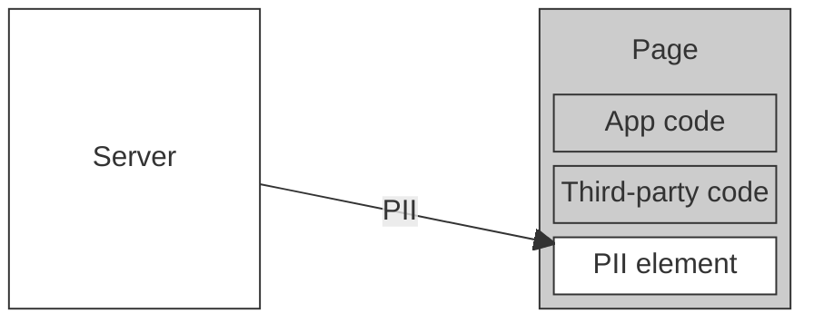
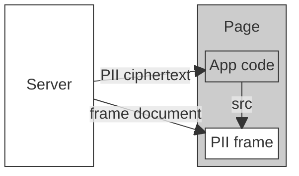
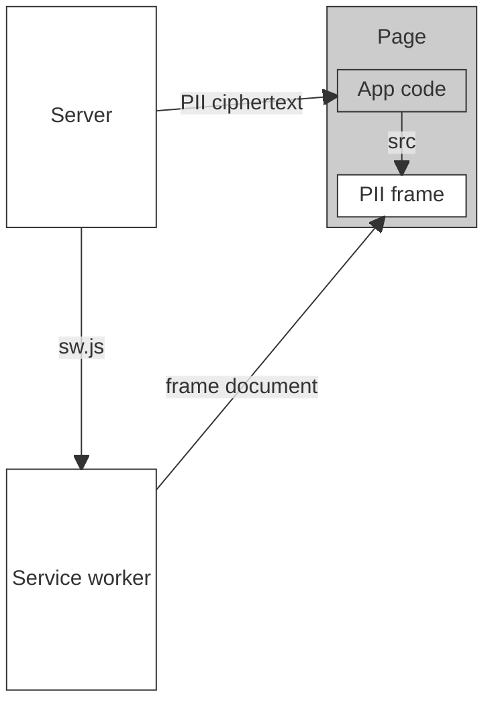

# Abstract

Normally the [origin](https://developer.mozilla.org/en-US/docs/Glossary/Origin) is the smallest trust boundary the browser enforces. Every script in a frame, and in every [same-origin](https://developer.mozilla.org/en-US/docs/Web/Security/Same-origin_policy) frame it can reach, can read and change the same DOM, storage, and credentials. However, an origin can create finer-grained trust boundaries at the granularity of [service worker](https://developer.mozilla.org/en-US/docs/Web/API/Service_Worker_API) [scopes](https://w3c.github.io/ServiceWorker/#scope-match-algorithm), using a service worker, the [Content-Security-Policy header `sandbox` directive](https://developer.mozilla.org/en-US/docs/Web/HTTP/Reference/Headers/Content-Security-Policy/sandbox), and an [iframe](https://developer.mozilla.org/en-US/docs/Web/HTML/Reference/Elements/iframe).

# Introduction

## Background

An origin is a URL's scheme, host, and port. Under the same-origin policy, a script can read and change the documents, storage, and cookies of its own origin, but not those of other origins. A service worker is a script the browser runs apart from any page. It acts as a proxy for the network requests of the pages and frames it controls, and can answer a request with a response it builds itself. A worker's registration controls the URLs under its scope, a URL prefix: a navigation goes to the registration whose scope is the longest prefix of its URL. By default, a scope must be within the directory of the worker's script. A [Content Security Policy](https://developer.mozilla.org/en-US/docs/Web/HTTP/Guides/CSP) (CSP) is a response header that restricts what a document may do, such as which scripts it may run. Its `sandbox` directive applies the restrictions of the iframe [`sandbox` attribute](https://developer.mozilla.org/en-US/docs/Web/HTML/Reference/Elements/iframe#sandbox) to a document, wherever it loads. `sandbox allow-scripts` lets the document run scripts but, without `allow-same-origin`, gives it an [opaque origin](https://html.spec.whatwg.org/multipage/browsers.html#concept-origin-opaque): an origin equal to no other origin. Other frames can't access its DOM or JavaScript globals, and it can't access the storage or cookies of its URL's origin.

## Motivation

Consider a web application that displays a user's personally identifiable information (PII), such as their address. The page fetches the PII and renders it into an element. Every script in the page, including third-party code, can read it.

It would be preferable to expose the PII only to the user and to the element that displays it, and to treat the rest of the page as untrusted.

One way: the page receives only PII ciphertext and displays it in `<iframe src="/pii/#<ciphertext>">`. The server returns a document that decrypts its fragment and renders the PII, and includes the `Content-Security-Policy: sandbox allow-scripts` header, causing the browser to assign the document an opaque origin. Because the document is not the same origin as the embedding page, it cannot access its contents, including the PII and the decryption key for the ciphertext.

Each frame costs a network round trip, so this is slow, and a network disruption stops the PII from rendering.

Instead, a service worker hosted at `/pii/sw.js` and registered with scope `/pii/` can answer the request for the frame's document locally.

## A Minimal Proof-of-Concept

See [`examples/minimal-poc`](../examples/minimal-poc) for a full proof-of-concept demonstrating this architecture. When the page loads with the service worker already installed:

1. The page finds the worker's registration with `getRegistrations()` and sends the worker a message.
2. The worker encrypts the string "setec astronomy" with its AES-GCM key and replies with the ciphertext.
3. The page inserts `<iframe src="/sandbox#<ciphertext>">`.
4. The worker answers the frame's request with a document that contains the key and a script, and with `Content-Security-Policy: sandbox allow-scripts`.
5. The frame's script decrypts the fragment and displays the plaintext.

## Necessary Constraints

This proof-of-concept has several vulnerabilities that must be mitigated.

### Any client can read the secret

Any client, not only the page, can request `/sw.js` and read the key. To prevent this, the server must return the worker's script only for authenticated requests, and return an error otherwise.

### The page can read the worker's source

Any page script can fetch `/sw.js` and read the key. To prevent this, the server must serve the worker's script only to requests with [`Sec-Fetch-Dest: serviceworker`](https://developer.mozilla.org/en-US/docs/Web/HTTP/Reference/Headers/Sec-Fetch-Dest), which scripts can't set, and [`Service-Worker: script`](https://w3c.github.io/ServiceWorker/#service-worker), and with `Cache-Control: no-store`, so the page can't read it from the HTTP cache. If either header is missing, the server must return `403 Forbidden`.

### The page can read the frame's document

The worker answers every request for `/sandbox`, not only navigations, and the `sandbox` directive doesn't apply to a `fetch` response. The page can create a same-origin iframe the worker controls, such as one at `/sandbox/x`, and call that frame's `fetch("/sandbox")` to read the key. To prevent this, the worker must only respond to requests whose [`mode`](https://developer.mozilla.org/en-US/docs/Web/API/Request/mode) is `"navigate"` and whose [`destination`](https://developer.mozilla.org/en-US/docs/Web/API/Request/destination) is `"iframe"`, which scripts can't set.
